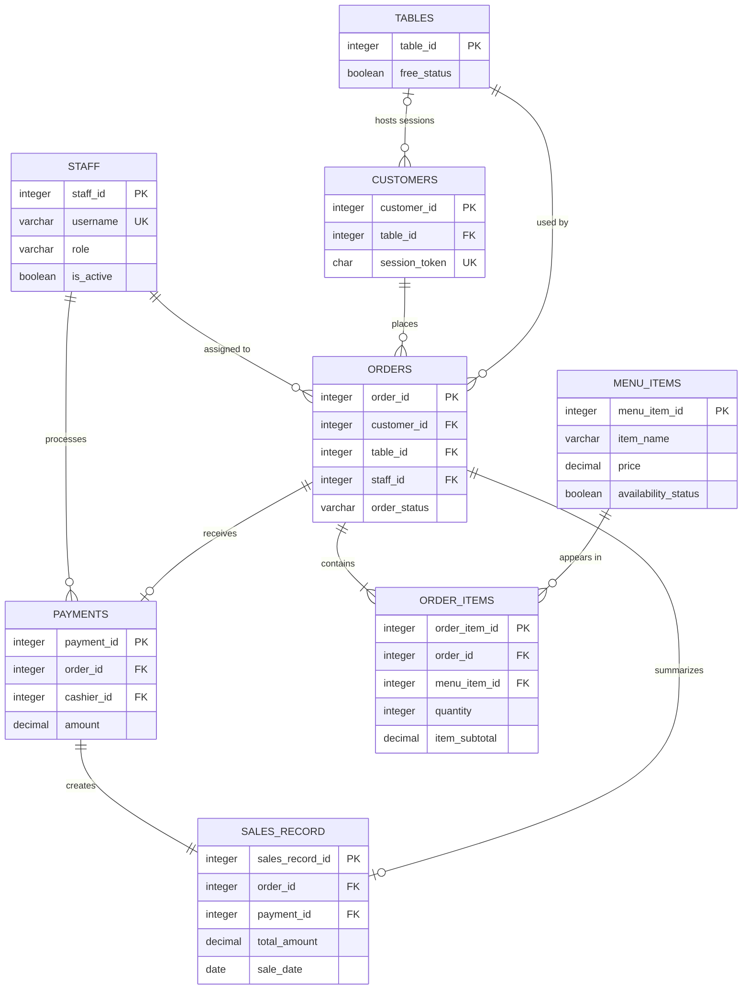

# Restaurant DBMS Design Reference

This document describes the PostgreSQL data model, API-to-table mappings, and
the end-to-end flow of the restaurant system. The application uses Django REST
Framework for HTTP endpoints and parameterized raw SQL repositories for the
restaurant tables.

## DBMS Choice and Storage Strategy

The selected DBMS is **PostgreSQL**, hosted on Neon. PostgreSQL is appropriate
for this system because restaurant transactions are relational: an order has a
customer, table, staff member, menu lines, and at most one payment. Foreign
keys, check constraints, transactions, indexes, and PL/pgSQL triggers keep
those relationships consistent at the database boundary.

- `DATABASE_URL` points the application at the pooled Neon PostgreSQL
  connection.
- `DATABASE_URL_UNPOOLED` is used for schema operations that need a direct
  connection.
- `backend/db_access.py` provides parameterized CRUD and query helpers. Table
  and column identifiers are validated before interpolation; values use SQL
  parameters.
- `backend/schema.sql` is the source of truth for the restaurant tables and
  trigger functions. These tables are intentionally not Django-managed ORM
  tables.
- The order and status indexes support queue and reporting lookups. The unique
  payment index prevents an order from being paid twice.
- The application uses `transaction.atomic()` for payment processing so the
  payment and trigger-created sales record are committed together.

## Data Dictionary

`PK` means primary key, `FK` means foreign key, and `NN` means `NOT NULL`.
Identity columns are generated by PostgreSQL. Defaults are applied when the
client does not provide a value.

### `staff`

| Column | Type | Required/default | Key, relationship, and validation |
| --- | --- | --- | --- |
| `staff_id` | `INTEGER` identity | NN | PK |
| `password` | `VARCHAR(128)` | NN | Stores a Django password hash, never a raw password |
| `last_login` | `TIMESTAMPTZ` | Optional | Updated after successful staff login |
| `is_superuser` | `BOOLEAN` | NN, `FALSE` | Django admin privilege flag |
| `username` | `VARCHAR(150)` | NN | Unique login identifier |
| `first_name` | `VARCHAR(150)` | NN, `''` | Staff profile attribute |
| `last_name` | `VARCHAR(150)` | NN, `''` | Staff profile attribute |
| `email` | `VARCHAR(254)` | NN, `''` | Staff profile attribute |
| `is_staff` | `BOOLEAN` | NN, `FALSE` | Django admin access flag |
| `is_active` | `BOOLEAN` | NN, `TRUE` | Disabled accounts cannot authenticate; activating wait staff can assign pending orders |
| `date_joined` | `TIMESTAMPTZ` | NN, current timestamp | Account creation time |
| `role` | `VARCHAR(30)` | NN, `'wait_staff'` | Must be `cashier`, `kitchen`, `wait_staff`, or `manager` |

### `tables`

| Column | Type | Required/default | Key, relationship, and validation |
| --- | --- | --- | --- |
| `table_id` | `INTEGER` identity | NN | PK |
| `free_status` | `BOOLEAN` | NN, `TRUE` | Availability state; changed by order, payment, and cancellation triggers |

### `customers`

| Column | Type | Required/default | Key, relationship, and validation |
| --- | --- | --- | --- |
| `customer_id` | `INTEGER` identity | NN | PK |
| `table_id` | `INTEGER` | Optional | FK to `tables.table_id`; `ON DELETE SET NULL` |
| `session_token` | `CHAR(36)` | NN | Unique customer session token, generated as a UUID by the API |
| `created_at` | `TIMESTAMPTZ` | NN, current timestamp | Session creation time |

### `menu_items`

| Column | Type | Required/default | Key, relationship, and validation |
| --- | --- | --- | --- |
| `menu_item_id` | `INTEGER` identity | NN | PK |
| `item_name` | `VARCHAR(100)` | NN | API validation requires 1-100 characters |
| `description` | `TEXT` | Optional | Menu description |
| `price` | `DECIMAL(10,2)` | NN | Must be greater than zero; subtotal trigger reads this value |
| `availability_status` | `BOOLEAN` | NN, `TRUE` | Unavailable items are hidden from the public menu; deletion is a soft delete |

### `orders`

| Column | Type | Required/default | Key, relationship, and validation |
| --- | --- | --- | --- |
| `order_id` | `INTEGER` identity | NN | PK |
| `customer_id` | `INTEGER` | NN | FK to `customers.customer_id`; `ON DELETE RESTRICT` |
| `table_id` | `INTEGER` | NN | FK to `tables.table_id`; `ON DELETE RESTRICT` |
| `staff_id` | `INTEGER` | Optional | FK to `staff.staff_id`; `ON DELETE SET NULL`; waiter assignment may fill it automatically |
| `order_status` | `VARCHAR(20)` | NN, `'pending'` | Must be `pending`, `confirmed`, `preparing`, `ready`, `served`, or `cancelled` |
| `order_time` | `TIMESTAMPTZ` | NN, current timestamp | Used by queue ordering and the order-time index |

### `order_items`

| Column | Type | Required/default | Key, relationship, and validation |
| --- | --- | --- | --- |
| `order_item_id` | `INTEGER` identity | NN | PK |
| `order_id` | `INTEGER` | NN | FK to `orders.order_id`; `ON DELETE CASCADE` |
| `menu_item_id` | `INTEGER` | NN | FK to `menu_items.menu_item_id`; `ON DELETE RESTRICT` |
| `quantity` | `INTEGER` | NN | Must be greater than zero |
| `item_subtotal` | `DECIMAL(10,2)` | NN, `0` | Derived by `order_items_subtotal_before_write`; not trusted from the client |
| `special_instructions` | `VARCHAR(255)` | Optional | Customer instructions for preparation |

### `payments`

| Column | Type | Required/default | Key, relationship, and validation |
| --- | --- | --- | --- |
| `payment_id` | `INTEGER` identity | NN | PK |
| `order_id` | `INTEGER` | NN | FK to `orders.order_id`; `ON DELETE RESTRICT`; unique index allows one payment per order |
| `amount` | `DECIMAL(10,2)` | NN | Must be greater than zero; calculated from order-item subtotals by the payment service |
| `payment_method` | `VARCHAR(20)` | NN | Must be `Cash` or `Mobile Money` |
| `cashier_id` | `INTEGER` | NN | FK to `staff.staff_id`; `ON DELETE RESTRICT`; endpoint requires cashier role |
| `transaction_time` | `TIMESTAMPTZ` | NN, current timestamp | Used to derive the Kampala-local sale date |

### `sales_record`

| Column | Type | Required/default | Key, relationship, and validation |
| --- | --- | --- | --- |
| `sales_record_id` | `INTEGER` identity | NN | PK |
| `order_id` | `INTEGER` | NN | FK to `orders.order_id`; `ON DELETE RESTRICT` |
| `payment_id` | `INTEGER` | NN | Unique FK to `payments.payment_id`; `ON DELETE RESTRICT` |
| `total_amount` | `DECIMAL(10,2)` | NN | Copied from the validated payment amount by the payment trigger |
| `sale_date` | `DATE` | NN, current date | Derived from payment time in `Africa/Kampala` by the payment trigger |

## Relationships and ERD

## Forms and API-to-Table Mapping

These are the backend form contracts. The React interface is tracked separately
in issues #2 and #3; until it is implemented, the endpoints can be exercised
with an API client or Django REST Framework tooling.

| Form/workflow | Endpoint | Access | Tables read or changed |
| --- | --- | --- | --- |
| Staff login | `POST /api/auth/login/` | Public | Reads `staff`; updates `staff.last_login` |
| Current staff session | `GET /api/auth/me/` | Staff token | Reads `staff` |
| Customer table session | `POST /api/customers/` | Public, throttled | Reads `tables`; inserts `customers` |
| Public menu | `GET /api/menu/` | Public | Reads available `menu_items` |
| Staff menu search | `GET /api/staff/menu/` | Any staff role | Reads `menu_items` |
| Create menu item | `POST /api/staff/menu/` | Manager | Inserts `menu_items` |
| Edit or hide menu item | `PATCH/DELETE /api/staff/menu/{id}/` | Manager | Updates `menu_items` |
| Place customer order | `POST /api/my/orders/` | Customer session | Reads `customers`, `menu_items`; inserts `orders` and `order_items` |
| Customer order history/detail | `GET /api/my/orders/` and `GET /api/my/orders/{id}/` | Customer session | Reads `orders`, `order_items`, `menu_items` |
| Cancel customer order | `POST /api/my/orders/{id}/cancel/` | Customer session | Updates `orders`; cancellation trigger may update `tables` |
| Staff order queue | `GET /api/staff/orders/` | Staff roles | Reads `orders`, `order_items`, `menu_items`, `staff` |
| Change order status | `POST /api/staff/orders/{id}/status/` | Kitchen, wait staff, manager | Updates `orders`; completion trigger may assign pending orders |
| Assign order | `POST /api/staff/orders/{id}/assign/` | Manager | Updates `orders` and `staff` relationship |
| Pay order | `POST /api/staff/orders/{id}/pay/` | Cashier | Reads `orders` and `order_items`; inserts `payments`; payment trigger inserts `sales_record` and may free `tables` |

## Reports and Query Mapping

All report endpoints require the manager role and accept inclusive `from` and
`to` dates. The default range is the last 30 days and the maximum range is 366
days.

| Report | Endpoint | Main tables | Output/insight |
| --- | --- | --- | --- |
| Daily sales | `GET /api/staff/reports/daily-sales/` | `sales_record` | Daily orders, revenue, average order value, including zero-sale days |
| Top menu items | `GET /api/staff/reports/top-items/` | `sales_record`, `order_items`, `menu_items` | Units sold and revenue by menu item |
| Waiter performance | `GET /api/staff/reports/waiter-performance/` | `staff`, `orders`, `sales_record` | Orders handled, revenue, and average order value per waiter |
| Table turnover | `GET /api/staff/reports/table-turnover/` | `tables`, `orders`, `sales_record` | Paid orders, parties served, revenue, and turnover per day |
| Payment methods | `GET /api/staff/reports/payment-methods/` | `payments`, `sales_record` | Payment count and revenue split for Cash and Mobile Money |

The report API supplies structured data for textual summaries and future
frontend charts. Graphical presentation is tracked in issue #4.

## Trigger and Validation Rules

| Database behavior | Event | Result |
| --- | --- | --- |
| `set_order_item_subtotal` | Insert or update an order item quantity/menu item | Calculates `quantity * menu_items.price` |
| `occupy_table_on_order` | Insert an order | Marks its table occupied |
| `handle_payment` | Insert a payment | Creates `sales_record` and frees the table when no unpaid active order remains |
| `free_table_on_cancel` | Change an order to `cancelled` | Frees the table when no other unpaid active order remains |
| `assign_waiter_on_new_order` | Insert a pending order without staff | Selects an available active waiter under an advisory transaction lock |
| `assign_pending_after_change` | A served or cancelled assigned order finishes | Attempts to assign waiting pending orders |
| `staff_assign_pending_after_available` | A waiter is inserted or becomes active | Attempts to assign waiting pending orders |

Application validation complements database constraints. Login validates
credentials and active status; menu endpoints validate names, prices, and
availability; order services validate item quantities and customer ownership;
payment services validate served status, payment method, positive calculated
total, and duplicate payment attempts.

## End-to-End Database Flow

1. **Startup and authentication:** the client opens the application entry
   point, submits staff credentials to `/api/auth/login/`, and receives a
   signed eight-hour bearer token. The staff role controls permitted actions.
2. **Customer session:** a customer selects a table through
   `/api/customers/`; the API verifies the table and creates a UUID-backed
   customer session in `customers`.
3. **Menu and order:** the client reads available `menu_items`, submits order
   lines, and the service inserts an `orders` row and its `order_items`. The
   order-item trigger calculates each subtotal, while the order trigger marks
   the table occupied and assigns an available waiter when possible.
4. **Fulfillment:** kitchen staff move assigned orders from `confirmed` through
   `preparing` to `ready`. The assigned waiter delivers and marks the order
   `served`; managers retain an override. Wait staff see only their own orders.
   Staff do not create orders; customer sessions submit them. Finishing or
   cancelling an assigned order can release the next pending order to a waiter.
5. **Payment:** a cashier can pay only a served order. The service locks the
   order, calculates the amount from stored subtotals, and inserts one payment.
   The payment trigger writes the sales record and frees the table when all
   active orders at that table are paid.
6. **Reporting:** a manager requests a validated date range. Report queries
   read completed sales and return daily, item, waiter, table, and payment
   aggregates for textual summaries and graphical visualizations.

## Sample Data

`seed.sql` provides development-only demonstration data: 20 rows for each
project table, with hashed demo staff passwords and relationships that exercise
order-item, payment, sales-record, and table-status triggers. Load it only into
a dedicated empty development database as described in the root
`README.md`; never use it to initialize the shared Neon branch.
