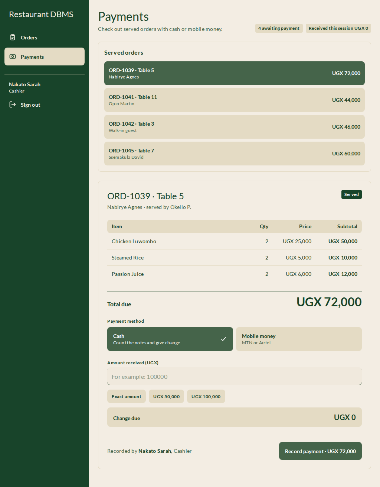
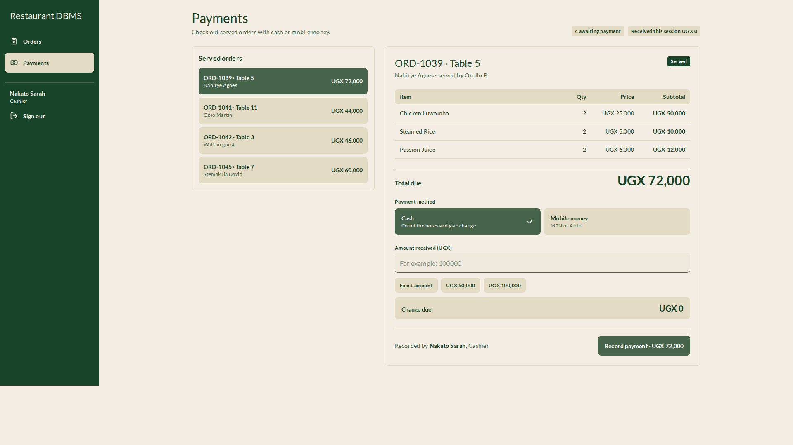
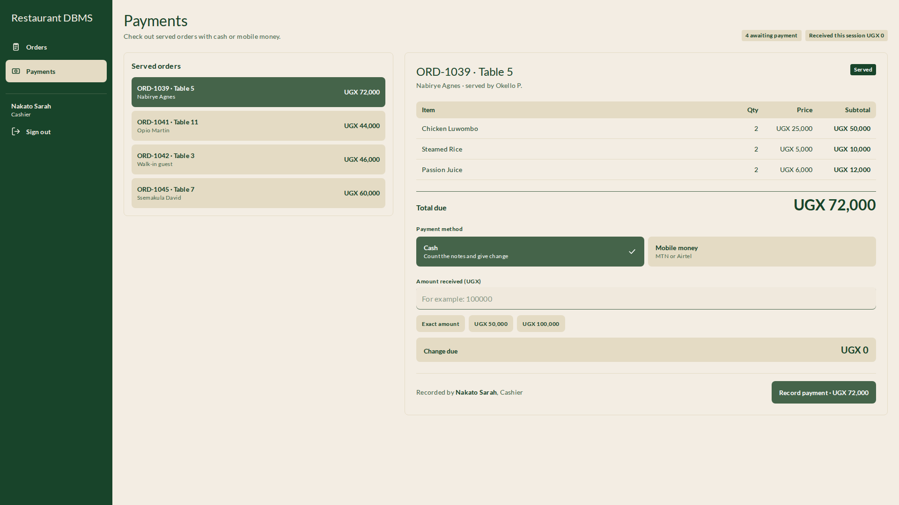
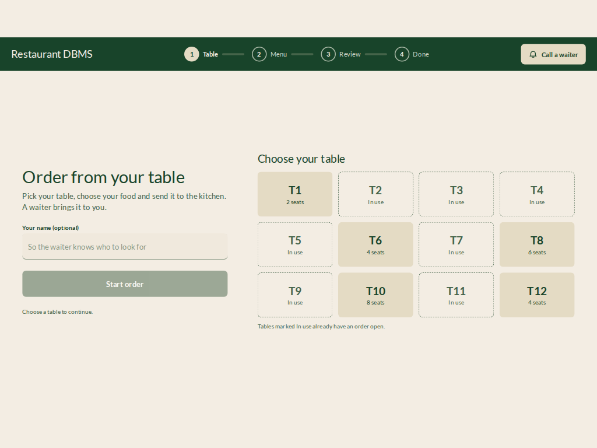
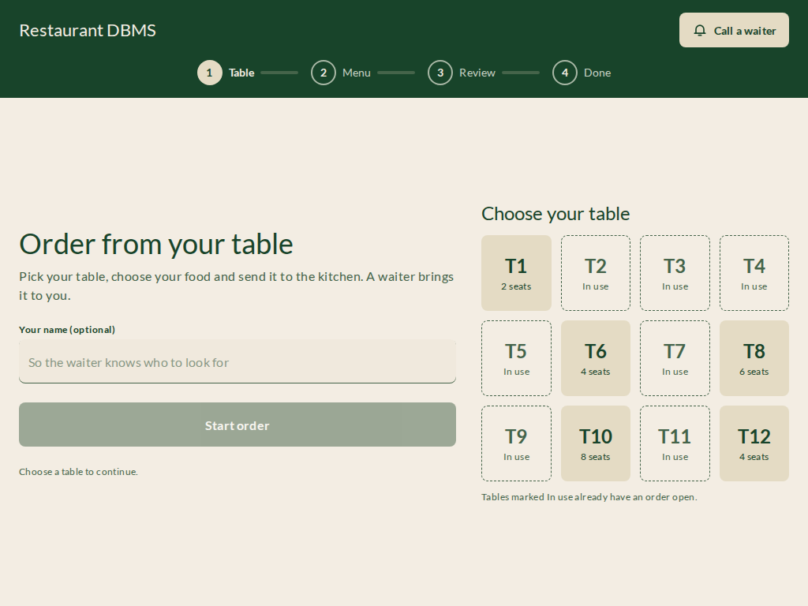
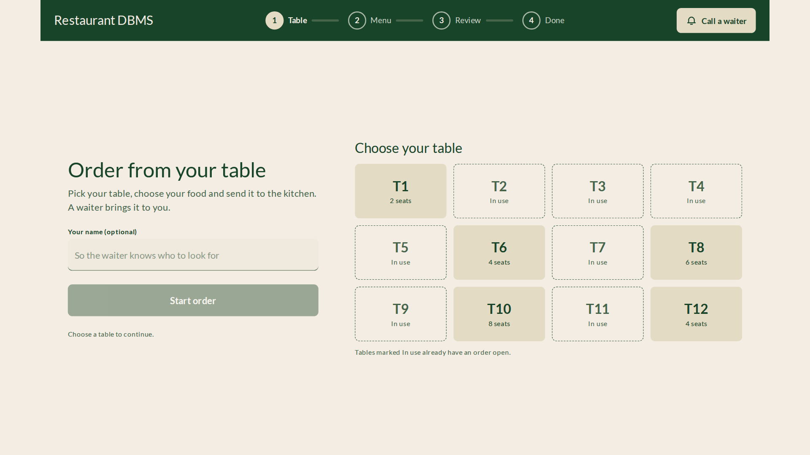
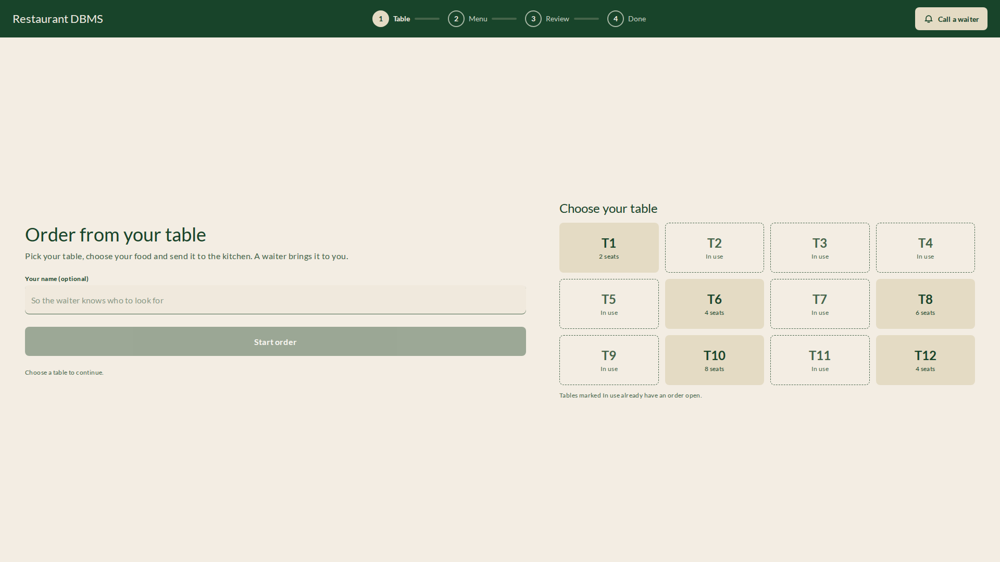
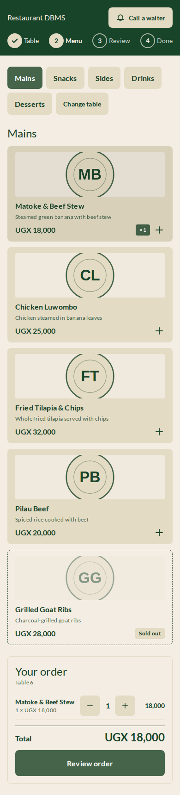
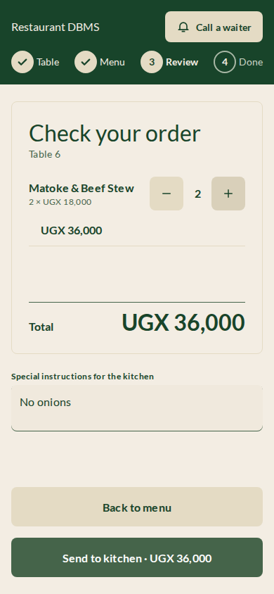

# Responsive workspace changes (#41)

These captures use the same fake API fixtures before and after the change.
They show the complete page at 1024×768 and 1920×1080. The original customer
screen scales text and buttons as part of a fixed canvas; the new screen uses
CSS pixels and reflows instead. Staff navigation now extends through the
viewport height, and content uses the remaining width.

| View                | Before                                              | After                                             |
| ------------------- | --------------------------------------------------- | ------------------------------------------------- |
| Staff, 1024×768     |        |        |
| Staff, 1920×1080    |       |       |
| Ordering, 1024×768  |   |   |
| Ordering, 1920×1080 |  |  |

## Portrait ordering

Menu and cart scroll naturally on one page; review lines wrap above the kitchen
note and full-width actions.

| Menu and cart, 390px                                  | Review, 390px                                    |
| ----------------------------------------------------- | ------------------------------------------------ |
|  |  |

## Verification

`frontend/tests/e2e/responsive.spec.ts` visits Orders, Payments, Menu, and Reports
at 512, 880, 1024, 1360, and 1920px widths. It checks full-height navigation on desktop,
full-width content, wrapping navigation, horizontal overflow, and visible
keyboard focus.

Customer tests walk table selection, menu categories, cart, review, kitchen
submission, confirmation, and reset at 1024×768, 1920×1080, 390×844 portrait,
and 512×384 (the CSS viewport of a 1024×768 display at 200% browser zoom).
They use keyboard activation, scroll focus into view, assert unchanged text and
touch control sizes, and check horizontal page overflow at each step. The zoom
case verifies reflow at the equivalent CSS viewport; it does not automate the
browser's zoom menu.

The original design reference images remain historical captures; current
ordering visual regression snapshots cover the reflowed layout.
